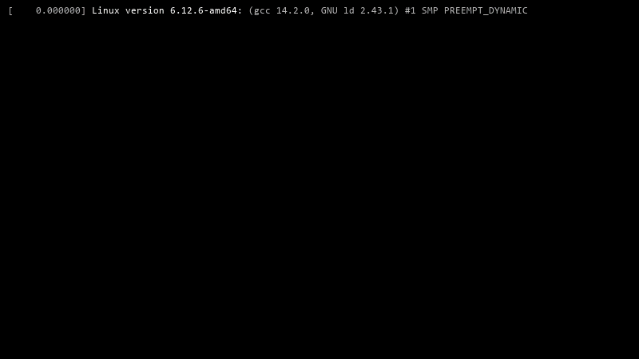
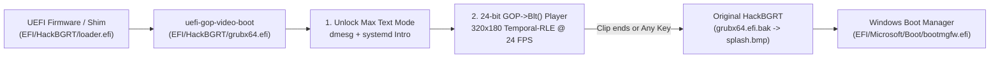

# uefi-gop-video-boot

[](https://github.com/wioledead/uefi-gop-video-boot)
[](https://github.com/wioledead/uefi-gop-video-boot)
[](https://github.com/wioledead/uefi-gop-video-boot)
[](https://github.com/wioledead/uefi-gop-video-boot)
[](https://wioledead.github.io/uefi-gop-video-boot/)
[](LICENSE)



> **Interactive Browser Studio & Converter:** [**https://wioledead.github.io/uefi-gop-video-boot/**](https://wioledead.github.io/uefi-gop-video-boot/) — trim `In / Out` clip ranges, switch `Fit` vs `Fill 16:9` framing, auto-fit tolerance to an ESP megabyte budget, test `GOP->Blt()` 255-color scanlines in real time, and export a ready-to-compile `video_frames.h` directly in your browser.

A freestanding **x86_64 UEFI pre-boot application** (`bootx64.efi` / `grubx64.efi`) written in pure C with **zero external runtime dependencies**. Designed as a drop-in stage for [HackBGRT](https://github.com/Metabolix/HackBGRT) or standalone UEFI boot chains, it replaces the static vendor POST experience with:

1. **Stage 1 — Live Hardware-Probed Linux `dmesg` Stream** (~1.2s, populated dynamically via `CPUID`, calibrated `RDTSC` MHz, `SMBIOS/DMI` motherboard info, `ACPI RSDP/XSDT` physical addresses with `Intel DMAR` / `AMD-Vi IVRS` auto-detection, `GetMemoryMap` `BIOS-e820` ranges & GiB RAM summary, and `efifb` GOP BAR).
2. **Stage 2 — Colored `systemd` Dependency Graph** (~3.5s, 50 units with burst/normal/hitch pacing and device highlights).
3. **Stage 3 — Full-Screen 24-bit TrueColor `GOP->Blt()` Video Player** (`320×180` tile grid scaled integer-exact to `1920×1080` / `2560×1440` / `3840×2160` at hardware-calibrated `24 FPS`, with interactive pause, Temporal-RLE frame/time seeking, scanline toggle, and `F2`/`Del` reboot-to-BIOS).
4. **Stage 4 — Loop-Safe Chainloader** handing control to original HackBGRT (`grubx64.efi.bak` → custom `ACPI BGRT` `splash.bmp`) and Windows Boot Manager (`bootmgfw.efi`).

---

## Technical Specifications

| Parameter | Specification |
| :--- | :--- |
| **Target Architecture** | `x86_64` PE32+ (`Subsystem 0x0A: EFI_APPLICATION`), MS x64 ABI |
| **Build Dependencies** | Zero external libs (`src/uefi_compat.h` standalone **or** system `gnu-efi` headers) |
| **Compilers Supported** | `x86_64-w64-mingw32-gcc` (Windows / MSYS2 / WSL) and `clang + lld` |
| **Console Unlock** | Bypasses `ConSplitterDxe` `80×25` serial caps by binding directly to physical `DevicePath`-backed `GOP` & `GraphicsConsoleDxe` |
| **Hardware Telemetry** | Live `CPUID` brand/threads/ISA (`AES-NI`/`AVX2`/`AVX-512`/`SHA-NI`), `SMBIOS/DMI`, `ACPI XSDT`, `GetMemoryMap`, `efifb` |
| **Video Codec** | 255-color adaptive 24-bit RGB (`MedianCut + K-Means`) + **Temporal-Delta RLE** (`UINT16` tokens) |
| **Grid & Scaling** | `320×180` (`16:9`) → `6×` = `1920×1080`, `8×` = `2560×1440`, `12×` = `3840×2160` (borderless) |
| **Pixel Blitter** | Unrolled 64-bit (`UINT64` = 2 pixels/store) offscreen render + dirty-band `GOP->Blt(EfiBltBufferToVideo)` |
| **Frame Timing** | Live `RDTSC` calibrated over `BS->Stall(20000)` to subtract actual render/PCIe time per frame |
| **Interactive Controls** | Skip (`Space`/`Enter`/`Esc`), intro skip (`Tab`), pause (`P`), seek `±2s` (`←`/`→`), step `±1f` (`,`/`.` ), scanlines (`S`), UEFI Setup (`F2`/`Del`) |
| **Secure Boot** | Embedded `.sbat` section compatible with Red Hat `shim` 15+ / 16+ & `MokManager` hash enrollment |
| **Footprint** | `~135 KB` (built-in 3s procedural demo) / `~8–13 MB` (30–35s `320×180` @ 24 FPS custom video) |

---

## Boot Chain & `GOP->Blt()` Architecture



### Why Direct `GOP->Blt()` Instead of `ConOut`?
1. **Breaking the `80×25` & 16-Color Wall:** Standard `EFI_SIMPLE_TEXT_OUTPUT_PROTOCOL` only exposes 16 EGA foreground colors (`0x00..0x0F`), and motherboard `ConSplitterDxe` drivers frequently clamp `SystemTable->ConOut` to `80×25` whenever UART/serial redirection is enabled. During the text intro, `PrepareMaxResolutionConsole()` locates the underlying `GraphicsConsoleDxe` handle directly bound to `EFI_GRAPHICS_OUTPUT_PROTOCOL` to unlock full native text density (e.g., `240×56` at 1080p).
2. **Tear-Free 24-Bit Video:** For video playback, `PlayGopVideo()` switches to direct pixel rendering in a RAM backbuffer (`UINT32` `0x00RRGGBB` matching `EFI_GRAPHICS_OUTPUT_BLT_PIXEL`), using 64-bit stores (`FillPixels32`) and subtle scanline shading on the bottom row of each `scale × scale` tile. Only the modified vertical scanline band (`dirty_y_min .. dirty_y_max`) is transferred per frame via a single `gGop->Blt(..., EfiBltBufferToVideo, ...)` burst.
3. **Temporal-Delta RLE Compression:** Each frame is mapped to a global 255-color 24-bit palette (`0..254`), while index `255` (`GOP_VIDEO_SKIP_INDEX`) encodes unchanged cells relative to the persistent backbuffer. Every run `(color_idx, run_length)` packs into a single `UINT16`, keeping both binary size and GCC AST parse time small.

---

## Quick Start & Building

The repository includes a lightweight 3-second procedural animation in `src/demo_frames.h`, so it compiles **immediately after `git clone`** with no video files required.

### Option A: Windows (MinGW-w64)
```powershell
git clone https://github.com/wioledead/uefi-gop-video-boot.git
cd uefi-gop-video-boot
mingw32-make
```

### Option B: Linux / WSL (MinGW-w64 or Clang + LLD)
```bash
sudo apt update && sudo apt install -y build-essential gcc-mingw-w64-x86-64
git clone https://github.com/wioledead/uefi-gop-video-boot.git
cd uefi-gop-video-boot
make

# Optional: build with Clang + LLD and system GNU-EFI headers
sudo apt install -y clang lld gnu-efi
make TOOLCHAIN=clang GNUEFI_INC=/usr/include/efi
```

Build outputs are placed in `efi/bootx64.efi`, `efi/grubx64.efi`, and `efi/loader.efi`.

> **Tip:** To jump straight into the video without the 4.5-second Linux `dmesg`/`systemd` intro, press `Tab` during boot or set `#define ENABLE_LINUX_INTRO 0` at the top of `src/main.c`.

### Interactive Pre-Boot Hotkeys

| Key | Stage | Action |
| :--- | :--- | :--- |
| `Space` / `Enter` / `Esc` / `Q` | Any (`dmesg`, `systemd`, Video) | Exit immediately and chainload Windows (`bootmgfw.efi`) |
| `Tab` | Linux Intro (`dmesg` / `systemd`) | Skip remaining text intro and start `GOP->Blt()` video immediately |
| `P` | Video Player | Pause / resume playback |
| `←` / `→` | Video Player | Seek backward / forward `±2 seconds` (exact Temporal-RLE state rebuild) |
| `,` / `.` | Video Player | Step `-1` / `+1` single frame (automatically pauses) |
| `R` / `Home` | Video Player | Restart video from frame `0` |
| `S` | Video Player | Toggle CRT scanline shading live |
| `F2` / `Del` | Any (`dmesg`, `systemd`, Video) | Set `EFI_OS_INDICATIONS_BOOT_TO_FW_UI` in NVRAM and reboot straight into UEFI BIOS Setup |

### Zero-Reboot Testing in QEMU + OVMF

Test the full UEFI boot flow (`dmesg` → `systemd` → `1920×1080` `GOP->Blt()` → chainload handoff) in a desktop window in ~2 seconds without rebooting your PC. `tools/run_qemu.py` packs a spec-compliant `MBR + FAT32` ESP image (`efi/esp_qemu.img`) in pure Python stdlib (no admin rights required) alongside a mock `\EFI\Microsoft\Boot\bootmgfw.efi` chainload verifier:

```powershell
# Install QEMU (includes OVMF edk2-x86_64-code.fd firmware on Windows)
winget install SoftwareFreedomConservancy.QEMU

# Build and boot in QEMU + OVMF (1920x1080 GOP over virtual NVMe)
mingw32-make qemu

# Instant <1s rebuild & boot using the built-in 3s procedural demo
mingw32-make qemu DEMO=1
```
*(On Linux/WSL: `sudo apt install -y qemu-system-x86 ovmf && make qemu`.)*

---

## Encoding Your Own Video & Live Terminal Preview

Install Python helpers once:
```bash
pip install opencv-python pillow numpy
```

1. **Preview any video clip live in Windows Terminal** (24-bit ANSI TrueColor half-blocks `▀`, zero reboots needed):
   ```bash
   python tools/preview_terminal.py path/to/input.mp4
   ```
   *(Controls: `Space` / `Esc` / `Q` to quit, `R` to replay from start.)*

2. **Encode your video into `src/video_frames.h` and rebuild:**
   ```bash
   python tools/video_to_color_ascii.py path/to/input.mp4 --fps 24 --width 320 --height 180 --max-mb 12.8
   make
   ```
   When `src/video_frames.h` is present, `src/main.c` automatically includes it via `__has_include("video_frames.h")` instead of `src/demo_frames.h`.

3. **Regenerate the built-in procedural demo (optional):**
   ```bash
   python tools/video_to_color_ascii.py --demo
   ```

---

## Deploying into HackBGRT (Without Modifying BIOS NVRAM Entries)

If [HackBGRT](https://github.com/Metabolix/HackBGRT) is already installed on your EFI System Partition (`\EFI\HackBGRT\`):

* **Default HackBGRT install (with Shim):** `\EFI\HackBGRT\loader.efi` is Red Hat's signed `shimx64.efi` (do **not** overwrite it!), which loads `\EFI\HackBGRT\grubx64.efi`. Back up the original `grubx64.efi` **once** to `grubx64.efi.bak`, then copy `efi/grubx64.efi` to `\EFI\HackBGRT\grubx64.efi`.
* **No-Shim HackBGRT install (`skip-shim`):** If `grubx64.efi` does not exist in `\EFI\HackBGRT\`, back up `loader.efi` **once** to `loader.efi.bak`, then copy `efi/loader.efi` to `\EFI\HackBGRT\loader.efi`.

### PowerShell Deployment Script (Run as Administrator)
```powershell
mountvol S: /S

# Check free space on ESP (ensure enough room for your .efi size)
Get-PSDrive S | Select-Object @{N='FreeMB';E={[math]::Round($_.Free/1MB, 1)}}

if (Test-Path "S:\EFI\HackBGRT\grubx64.efi") {
    # Back up original HackBGRT ONLY ONCE (never overwrite .bak with our custom binary!)
    if (-not (Test-Path "S:\EFI\HackBGRT\grubx64.efi.bak")) {
        Copy-Item "S:\EFI\HackBGRT\grubx64.efi" "S:\EFI\HackBGRT\grubx64.efi.bak"
    }
    Copy-Item ".\efi\grubx64.efi" "S:\EFI\HackBGRT\grubx64.efi" -Force
} else {
    if (-not (Test-Path "S:\EFI\HackBGRT\loader.efi.bak")) {
        Copy-Item "S:\EFI\HackBGRT\loader.efi" "S:\EFI\HackBGRT\loader.efi.bak"
    }
    Copy-Item ".\efi\loader.efi" "S:\EFI\HackBGRT\loader.efi" -Force
}

mountvol S: /D
```

---

## Safety & Recovery

Modifying files on the EFI System Partition requires care. Built-in safeguards and recovery steps:

1. **Built-in Infinite-Loop Protection (`IsValidBackupEfi`):** Before chainloading `grubx64.efi.bak` or `loader.efi.bak`, `src/main.c` scans the binary to verify it contains neither our own `LinuxBootSim` marker nor `UEFI shim`. If a `.bak` file was accidentally overwritten, it is skipped automatically and boot falls back directly to `\EFI\Microsoft\Boot\bootmgfw.efi`.
2. **Never Touch `\EFI\Microsoft\Boot\bootmgfw.efi`:** Keep the native Microsoft Boot Manager intact. Using a separate `\EFI\HackBGRT\` entry means Windows Boot Manager always remains available in your motherboard's F8/F11/F12 UEFI Boot Menu.
3. **Secure Boot & `MokManager`:** If Secure Boot is enabled via Shim, replacing `grubx64.efi` changes its SHA-256 hash. On the next boot, Shim will launch `MokManager`: choose `Enroll hash from disk` → select your ESP → `EFI/HackBGRT/grubx64.efi` → `Continue` → `Yes` → `Reboot`.
4. **Disable Windows Fast Startup:** Windows Hybrid Shutdown (`HiberbootEnabled`) hibernates the kernel and can bypass full boot chains on cold power-up. Disable *Turn on fast startup* in Control Panel → Power Options, or test via *Restart*.
5. **Instant Rollback / Emergency Recovery:**
   * **From UEFI Boot Menu (F11 / F12 at power-on):** Select **Windows Boot Manager** directly to boot into Windows, then run:
     ```powershell
     mountvol S: /S
     Copy-Item "S:\EFI\HackBGRT\grubx64.efi.bak" "S:\EFI\HackBGRT\grubx64.efi" -Force
     mountvol S: /D
     ```
   * **From a Windows Installation USB (Shift + F10 Command Prompt):**
     ```cmd
     diskpart
     list vol
     sel vol <ESP_VOLUME_NUMBER>
     assign letter=S
     exit
     copy /Y S:\EFI\HackBGRT\grubx64.efi.bak S:\EFI\HackBGRT\grubx64.efi
     ```

---

## License

Released under the [MIT License](LICENSE).
